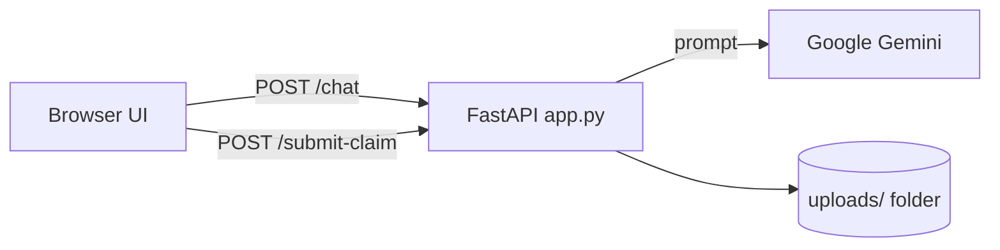

<div align="center">

# Insurance AI Chatbot (Gemini + FastAPI)

**A customer-service chatbot prototype for a property and casualty insurer, built on Google Gemini and FastAPI, with voice input and claim file uploads.**


</div>

---

## Overview

This is a single-page chat assistant themed around Great American Insurance Group. A FastAPI backend wraps every user question in a prompt that sets a customer-service persona and asks for an HTML-formatted answer, then sends it to Google's `gemini-pro` model. The browser renders the formatted reply. The UI also has quick-question buttons, a "Get a Quote" helper, speech-to-text input, and a modal for submitting a claim with attachments.

> **Disclaimer:** this is an independent project. It is not affiliated with or endorsed by Great American Insurance Group. The company facts and contact details in the prompt are hardcoded and may be out of date. Answers are generated by an LLM and may be wrong.

## Features

- **Gemini-powered answers**: `POST /chat` sends the question with a fixed system-style prompt to `gemini-pro` and returns the generated HTML.
- **Suggested questions**: one-click prompts for products and claims, plus a "Get a Quote" button that shows static quote guidance on the client.
- **Voice input**: uses the browser's `webkitSpeechRecognition` API, where available.
- **Claim submission**: a modal form sends a description and files (PDF, JPG, PNG, DOC) to `POST /submit-claim`. The server saves them under `uploads/claim_<timestamp>/`.
- **Typing indicator and responsive layout** in plain HTML, CSS and JavaScript.
- **Vercel-ready**: `vercel.json` routes all requests to `app.py`, and `api/index.py` exposes a Mangum handler.

## Tech stack

| Layer | Technology |
|-------|------------|
| Backend | Python, FastAPI 0.68, Uvicorn, Pydantic, python-multipart |
| AI | `google-generativeai` 0.3.1 (`gemini-pro`) |
| Front end | Jinja2 template, vanilla JavaScript, CSS |
| Deployment | Vercel (`@vercel/python`), Mangum adapter |

## Architecture



## API

| Method | Path | Description |
|--------|------|-------------|
| `GET` | `/` | Renders `templates/index.html` |
| `POST` | `/chat` | Body `{ "message": "..." }` returns `{ "response": "<html>" }` |
| `POST` | `/submit-claim` | Multipart form with `description` and optional `files[]`. Saved to disk. |

## Project structure

```
app.py                 # FastAPI app: routes, Gemini prompt, claim upload
api/index.py           # Mangum handler for Vercel
templates/index.html   # Chat UI
static/js/main.js      # Chat, quick questions, quote helper, voice input, claim modal
static/css/            # Styles
data/                  # Synthetic Q&A generator + dataset (not used by app.py)
vercel.json            # Vercel build and routes
requirements.txt
```

## Getting started

**Prerequisites:** Python 3.8+ and a Google AI Studio (Gemini) API key.

```bash
git clone https://github.com/abhiishek340/AI-Chatbot-Great-American-Insurance-.git
cd AI-Chatbot-Great-American-Insurance-
python -m venv venv && source venv/bin/activate
pip install -r requirements.txt
```

Create a `.env` file:

| Variable | Description |
|----------|-------------|
| `GOOGLE_API_KEY` | Google Gemini API key |
| `AI_MODEL` | Label passed to the template (defaults to `gemini`) |

```bash
python app.py        # or: uvicorn app:app --reload
# open http://localhost:8000
```

To deploy on Vercel, add `GOOGLE_API_KEY` as a project secret. `vercel.json` references it as `@google_api_key`.

## Limitations

- **No retrieval:** `data/bank_qa.py` has keyword-based context lookup over a generated Q&A set, but `app.py` never calls it. Answers come from the prompt and the model only.
- **Uploads go to local disk.** They do not persist on serverless hosts. Filenames are not sanitized and there is no authentication.
- CORS allows all origins. `templates/login.html` and `static/js/login.js` are empty placeholders.
- `gemini-pro` and the pinned SDK version are old. Newer Gemini model names may be required.

---

<div align="center">
Built by <a href="https://github.com/abhiishek340">Abhishek Yadav</a>
</div>
